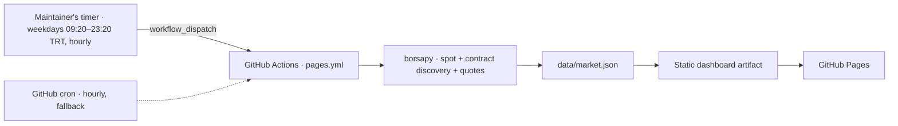

# Vade — TRY VİOP Futures Curves

A zero-backend GitHub Pages dashboard for USD/TRY, EUR/TRY, and XAU/TRY spot
references and every listed futures contract on Borsa İstanbul's VİOP market.
Market data is pulled with [borsapy](https://github.com/saidsurucu/borsapy) and
redeployed by GitHub Actions every hour during VİOP trading hours on weekdays,
09:20–23:20 Istanbul time.

## What it shows

- A top-level switch for USD/TRY, EUR/TRY, and XAU/TRY
- Current spot reference, daily range, and daily change for each market
- Automatic discovery of new dated contracts across all three VİOP families
- Last price, daily change, bid/ask, volume, and premium to spot
- Official contract maturity date and calendar days remaining
- Responsive price and implied-yield curves plus the full contract board
- Daily, 30-day monthly, and 365-day annualized yields in the chart and contract table
- For USD/TRY, the spot's average daily appreciation over the last 180 days and
  the expected profit from shorting each contract at the bid
- Snapshot age, delayed-data and market-closed states, and one-click refresh
- Any archived end-of-day close, browsable from the **View** menu
- Any earlier archived close overlaid on both curves, with price and yield deltas

Maturity is calculated as the final **full** Turkish business day of each
contract month. Weekends, public holidays, and half-day official holidays are
excluded in line with Borsa İstanbul's
[FX](https://www.borsaistanbul.com/en/markets/viop/futures/fx-futures) and
[precious-metals](https://www.borsaistanbul.com/en/markets/viop/futures/precious-metals-futures)
futures specifications.

## How it works



A systemd user timer on the maintainer's machine starts the Pages workflow with
`gh workflow run pages.yml` every hour at :20 on weekdays, from 09:20 to 23:20
Istanbul time, which covers VİOP's sessions and the 23:15 end-of-day archive
cutoff. The workflow's own hourly `20 * * * *` schedule stays as a fallback,
but GitHub runs it only every few hours in practice. Refreshes pause overnight, at weekends,
and whenever that machine is offline; see
[Publish on GitHub Pages](#publish-on-github-pages) to set up your own trigger.

The dashboard's status reflects that schedule, in Europe/Istanbul time whatever
the browser's own zone. Inside the weekday 09:20–23:20 window, a live snapshot
at most 90 minutes old shows as **Latest snapshot**, and an older one as
**Update delayed**. Outside it, a snapshot no more than 90 minutes older than
the last scheduled refresh (23:20 on the most recent weekday, so taken at 21:50
or later) shows a neutral **Market closed** with its time; an older one still
shows **Update delayed**, so a dead trigger stays visible. Weekday public
holidays need no special case, because the timer still fires on them.

The workflow only replaces the live site after a complete, valid snapshot
is produced. If upstream market data is temporarily unavailable, the job fails
and the previous successful Pages deployment stays online.

Every snapshot is checked against an explicit schema before it is written.
`scripts/snapshot_schema.py` encodes schema version 4: the top-level fields,
each market's units and spot, and every contract's keys, ISO dates, numeric
types (finite numbers or null, never strings, NaN or booleans), non-negative
days to maturity, a `status` that matches `last`, sorted contracts without
duplicate symbols, and at least one priced contract per market. The strings
the dashboard renders must keep the updater's formats: VİOP symbols like
`USDTRYV2026`, table codes like `F_USDTRY1026`, and labels like `Oct 2026`, so
markup in upstream data is rejected before it is published. It lists every
problem it finds by path. A snapshot that fails counts as a failed attempt, so
it is never published. Check a file by hand with
`python -m scripts.snapshot_schema data/market.json`.

The yield curve starts with the gross daily factor
`(contract price / spot rate)^(1 / days left)`. The chart converts the selected
1-, 30-, or 365-day compounded factor to net percentage yield by subtracting
one and multiplying by 100.

Days left are counted from the snapshot's market date, and refreshes can land
hours apart, so the live snapshot can still be from the previous day after
midnight. When the live snapshot's `market_date` is earlier than today in
Europe/Istanbul (whatever the browser's own time zone), the dashboard
recomputes, on a copy, everything that depends on time to maturity: days left,
the daily factor and the 1D/30D/365D yields, the curve horizon, and the USD/TRY
expected spot and profit. It uses the updater's rules, so a contract maturing
today shows 0 days and no yield, and a contract that has matured is dropped.
Prices, premiums and the spot trend stay as published. A note under the data
status says so, for example "Days left and yields adjusted to 08 Oct 2026;
prices are from the 07 Oct 2026 snapshot". Archived closes and comparison
overlays always keep their stored values, since each describes its own day.

### USD/TRY short carry

The short-carry section projects spot forward at its recent pace and compares
that with the price a short could sell at today:

- **Daily appreciation** = `(spot today / spot 180 days ago)^(1 / days)`. The
  start is the last daily close on or before 180 calendar days ago, so the
  window is exactly 180 days unless that date was a weekend or holiday, in which
  case the exponent uses the actual gap.
- **Expected spot at maturity** = `spot today × daily appreciation^(days left)`
- **Expected profit** = `(bid − expected spot at maturity) × 1,000` TRY per
  contract, since one VİOP USD/TRY contract is 1,000 USD.

Contracts without a bid show no profit. The projection ignores fees, taxes, and
margin and is not a forecast. If the 180-day history cannot be fetched, the
rest of the snapshot still publishes without the projection.

## History

Each refresh overwrites `data/market.json`, so the Pages workflow also keeps one
end-of-day snapshot per VİOP trading day on a separate `data-history` branch.
`main` never receives these commits.

- **Layout.** `history/<YYYY-MM-DD>.json` holds the snapshot exactly as
  `scripts/update_data.py` wrote it, named after the trading day it closes.
  `history/index.json` lists the archived days, sorted by date, as
  `{ "date", "generated_at", "markets" }` entries under a `schema_version`, so
  the dashboard never needs a directory listing.
- **End-of-day rule.** VİOP's
  [trading hours](https://www.borsaistanbul.com/en/markets/viop/market-functioning/trading-hours)
  run from the 09:20 opening session through the 19:00–23:00 evening session
  for FX and precious-metal futures. A snapshot taken at or after 23:15 on
  trading day D counts as D; the 15 minutes allow for delayed quotes. So does
  any snapshot taken before the next session opens at 09:20, including over
  weekends and public holidays. Snapshots taken in between, including the gap
  between the normal and evening sessions, are not end-of-day and are skipped.
- **Half days.** A half-day holiday is still a trading day, but its only session
  ends at 12:40 and it has no evening session, so snapshots from 12:55 onward
  count as that day. On the year's last trading day the evening session is not
  held either; the archive still waits until 23:15, which only delays it.
- **Write-once.** The first end-of-day snapshot for a day wins. An existing day
  is never overwritten, and a run that adds nothing makes no commit.
- **Validated.** `archive()` runs the same schema check before it writes
  anything, so a snapshot that fails it is never archived. The dashboard also
  rejects a live or archived file with an unknown `schema_version`, or with
  contracts missing their maturity date or days to maturity, and shows its
  usual load error.
- **Size.** About 27 KB per trading day, roughly 7 MB a year.

### Browsing past closes

When the site has archived days, a **View** menu appears next to the data
status. It lists **Live** and every archived close, newest first. Choosing a
close renders the whole dashboard (spot, curves, yields, carry and the contract
board) from that day's snapshot, for every market.

- **Unmistakable.** A "Past close" banner and a "Historical · close of …"
  status replace the live freshness state. The one-minute poll never replaces a
  past close; **Back to live**, **Refresh**, or choosing **Live** returns to live
  data.
- **Shareable.** `?date=YYYY-MM-DD` opens a close directly and combines with
  `?market=`, for example `?date=2026-10-27&market=EURTRY`. Switching markets
  keeps the date. A date that isn't archived falls back to live with a short
  notice.
- **Published with the site.** The Pages `build` job checks out `data-history`,
  if it exists, and `scripts/build_site.sh` copies its `history/` into
  `_site/data/history/`, so the files are served from the same origin. A close
  archived by a run appears in the next run's deploy. Without the branch the
  site ships an empty manifest and the menu stays hidden.

### Comparing two closes

A **Compare with** menu above the curves overlays an earlier archived close on
both the price and the yield curve, for every market. It offers **None** (the
default), quick picks for **1 week**, **1 month** and **3 months** ago, and
every archived close that is earlier than the day on screen. The live view
counts as its market date.

- **Quick picks.** Each one is the archived close nearest to the target date,
  offered only if it lies within 3, 7 or 14 calendar days of it respectively.
  Two picks that land on the same close are shown once.
- **Drawing.** The comparison is a dashed purple line with hollow square
  markers; the day on screen keeps its solid black line, round markers and
  fill. A legend above each chart names both dates.
- **Alignment.** Contracts are matched by maturity month. The x axis has one
  evenly spaced slot per maturity month listed on either day, so a contract
  that has since expired, or wasn't listed yet, still sits in its own month and
  only one line passes through it.
- **Deltas.** Tooltips show both days' values and the change from the
  comparison to the day on screen: **Δ price** = price on screen − comparison
  price, in the market's quote unit, and **Δ yield** = yield on screen −
  comparison yield, in percentage points (pp), for the selected 1D, 30D or
  365D period. Each day's yield uses that day's own spot and days to maturity.
  A contract missing on either day shows "not listed" and no delta.
- **Shareable.** `?compare=YYYY-MM-DD` combines with `?date=` and `?market=`,
  for example `?date=2026-10-05&compare=2026-09-30&market=XAUTRY`, and survives
  market and yield-period switches. A comparison that isn't archived, or isn't
  earlier than the day on screen, is dropped with a short notice. Without
  history the menu stays hidden.

To try it locally, put a copy of the branch's `history/` directory at the repo
root (it's ignored by git) or point `HISTORY_DIR` at one, then run
`bash scripts/build_site.sh` and serve `_site/`.

The `archive` job runs after `build`, alongside `deploy`, so a failed archive
never blocks or undoes the Pages deploy. It is the only job with
`contents: write` and pushes only to `data-history`, never with force. The
logic lives in `scripts/archive_snapshot.py`, and
`scripts/archive_history.sh SNAPSHOT [WORKTREE]` runs it against a checkout of
the branch, creating the branch as an orphan holding only `history/` on the
first run.

## Publish on GitHub Pages

1. Push this repository to GitHub with `main` as the default branch.
2. Open **Settings → Pages** and choose **GitHub Actions** as the source.
3. Open **Actions** and run **Refresh market data and deploy Pages**, or wait for
   the push-triggered run.

The same workflow runs at `20 * * * *` and can also be started manually.
GitHub may delay scheduled jobs during periods of high load, and in practice
this schedule fires only every few hours. Scheduled workflows in inactive
public repositories can also be disabled after 60 days. So the hourly cron is
only a fallback: the dashboard's hourly cadence comes from an external
trigger that dispatches the workflow during trading hours.

This repository's trigger is a systemd user timer on the maintainer's machine,
kept outside the repository. A fork needs its own. On a Linux machine with
`gh` logged in to an account that can run the fork's workflows, a oneshot
service runs:

```bash
gh workflow run pages.yml --repo <owner>/<repo> --ref main
```

and a timer starts it with these lines in its `[Timer]` section (weekdays,
09:20 through 23:20 Istanbul time, every hour at :20):

```ini
OnCalendar=Mon..Fri *-*-* 09..23:20:00 Europe/Istanbul
```

Refreshes stop whenever that machine is offline; the dashboard then shows
**Update delayed** once its snapshot is older than the schedule allows.

## Run locally

Python 3.10 or newer is required (the workflow uses Python 3.12).

```bash
python -m venv .venv
source .venv/bin/activate
python -m pip install -r requirements.txt
python -m unittest discover -s tests -v
python scripts/update_data.py
python -m http.server 8000
```

Then open <http://localhost:8000>.

To assemble the deployable site into `_site/` exactly as the Pages workflow
does, run `bash scripts/build_site.sh`.

To run the headless browser smoke test of the dashboard, install the dev
requirements and a Playwright Chromium, then run the test directly:

```bash
python -m pip install -r requirements-dev.txt
python -m playwright install chromium
python -m unittest tests/e2e/test_dashboard_smoke.py -v
```

It builds the site twice, with a small test-only history derived from
`tests/fixtures/market.json` and without any, swaps in that fixed snapshot,
serves both on a local port, and checks every market, the history view and the
comparison overlay in headless Chromium for console errors and the main
rendered values. The browser clock is pinned to the fixture's market date;
separate cases move it to later Istanbul days and check the recomputed days
left, yields and carry against hand-computed values, and check the data status
inside and outside the refresh window, in Istanbul and other time zones. It never touches the
network. The `discover` command above skips it, so the updater tests still run
without a browser.

**Accessibility.** The smoke test also runs
[axe-core](https://github.com/dequelabs/axe-core), bundled with
`axe-playwright-python`, against the WCAG 2.1 A and AA rules. It audits the
live view of each market, a past close with its banner, a comparison overlay
with both legends and a tooltip showing, a tooltip opened from the keyboard on
each chart, each yield period, a 390×844 mobile viewport and the load-error
state. It fails on any serious or critical violation and lists each one's
rule, impact, element and help text. As an automated check, it can't judge
everything WCAG asks for, such as whether labels make sense.

Each chart is one Tab stop, with a labelled summary and the contract table as
its full text alternative. On a focused chart, Left and Right arrow step
through the maturities, Home and End jump to the first and last, and Escape
hides the tooltip; Tab moves on as usual. The tooltip matches the pointer's,
a ring marks the active point, and a polite live region reads out the same
text: the maturity, its price or yield, days left, the peak note and, with a
comparison on, both days' values and the change. Separate smoke-test cases
cover these keys on both charts.

## Continuous integration

`.github/workflows/ci.yml` runs on every pull request, on pushes to branches
other than `main`, and on demand. It never deploys. It runs the updater tests
offline on Python 3.10 and 3.12, checks `app.js` syntax with `node --check`,
checks that `data/market.json` parses, validates it and
`tests/fixtures/market.json` with `scripts/snapshot_schema.py`, and assembles
the site with `scripts/build_site.sh`, which fails if any file the site needs
is missing.
A separate `smoke` job installs `requirements-dev.txt` and Chromium and runs
`python -m unittest tests/e2e/test_dashboard_smoke.py -v`, including the
accessibility audit.

## Data notes

- Futures discovery uses `borsapy.viop_contracts(..., full_info=True)` for
  `USDTRY`, `EURTRY`, and `XAUTRY`.
- Quotes use `borsapy.TradingViewStream`; the borsapy VİOP table provides a
  fallback and supplementary turnover data.
- USD/TRY and EUR/TRY spot use borsapy's 15-minute FX history with `.current`
  as a fallback. XAU/TRY combines 15-minute XAU/USD and USD/TRY data into a
  TRY-per-gram reference, with `FX("gram-altin").current` as a fallback.
- The 180-day USD/TRY reference uses borsapy's daily FX history
  (`FX("USD").history(...)`, sourced from canlidoviz).
- The dashboard polls its deployed JSON every minute, while the published
  snapshot is rebuilt every hour on weekdays, 09:20–23:20 Istanbul time,
  by the externally dispatched GitHub Actions workflow described above.
- VİOP and TradingView market data may be delayed by approximately 15 minutes.

This project is for personal and educational use only. It is not investment
advice. Review borsapy's upstream data-license disclaimer before use; commercial
market-data use may require a Borsa İstanbul license.
