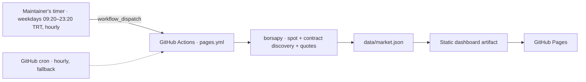
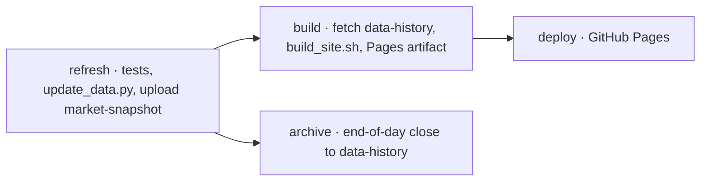

# Vade — TRY VİOP Futures Curves

A zero-backend GitHub Pages dashboard for USD/TRY, EUR/TRY, and XAU/TRY spot
references and every listed futures contract on Borsa İstanbul's VİOP market.
Market data is pulled with [borsapy](https://github.com/saidsurucu/borsapy) and
redeployed by GitHub Actions every hour during VİOP trading hours on weekdays,
09:20–23:20 Istanbul time.

## What it shows

- A top-level switch for USD/TRY, EUR/TRY, and XAU/TRY
- Current spot reference, daily range, and daily change for each market
- Automatic discovery of new dated contracts across all three VİOP families
- Last price, daily change, bid/ask, volume, and premium to spot
- Each contract's last-trade time, with a **stale** tag on contracts that
  didn't trade on the market's latest quote day, and a dotted marker for them
  on both curves
- Official contract maturity date and calendar days remaining
- Responsive price and implied-yield curves plus the full contract board
- Daily, 30-day monthly, and 365-day annualized yields in the chart and contract table
- For USD/TRY, the spot's average daily appreciation over the last 180 days and
  the expected profit from shorting each contract at the bid
- Snapshot age, delayed-data and market-closed states, and one-click refresh
- Any archived end-of-day close, browsable from the **View** menu
- Any earlier archived close overlaid on both curves, with price and yield deltas
- One exact contract's archived closes as a **History** table in the inspector,
  loaded on demand, with every missing value and capture gap shown as such,
  and a small chart of its yield on those closes whose points open their day
- A **Copy link** button that says whether the link it copies will change:
  a live link that opens the newest data, or a link pinned to the archived
  close on screen
- A **Download CSV** of the contract board, with the compared close when one is on
- A **Print** layout, from the button beside it or the browser's own print
  command: a header names the market, the live snapshot time or archived
  close, any compared close, selected maturity and yield period, the page
  link and the print time; controls drop out and every table column fits
  an A4 or Letter page

Maturity is calculated as the final **full** Turkish business day of each
contract month. Weekends, public holidays, and half-day official holidays are
excluded in line with Borsa İstanbul's
[FX](https://www.borsaistanbul.com/en/markets/viop/futures/fx-futures) and
[precious-metals](https://www.borsaistanbul.com/en/markets/viop/futures/precious-metals-futures)
futures specifications.

## How it works



A systemd user timer on the maintainer's machine starts the Pages workflow with
`gh workflow run pages.yml` every hour at :20 on weekdays, from 09:20 to 23:20
Istanbul time, which covers VİOP's sessions and the 23:15 end-of-day archive
cutoff. The workflow's own hourly `20 * * * *` schedule stays as a fallback,
but GitHub runs it only every few hours in practice. Refreshes pause overnight, at weekends,
and whenever that machine is offline; see
[Publish on GitHub Pages](#publish-on-github-pages) to set up your own trigger.

The dashboard's status reflects that schedule, in Europe/Istanbul time whatever
the browser's own zone. Inside the weekday 09:20–23:20 window, a live snapshot
at most 90 minutes old shows as **Latest snapshot**, and an older one as
**Update delayed**. Outside it, a snapshot no more than 90 minutes older than
the last scheduled refresh (23:20 on the most recent weekday, so taken at 21:50
or later) shows a neutral **Market closed** with its time; an older one still
shows **Update delayed**, so a dead trigger stays visible. Weekday public
holidays need no special case, because the timer still fires on them.

**Update delayed** names the snapshot's time and its age, rounded down to whole
hours under two days and to whole days after that, for example
`Update delayed · snapshot 07 Oct, 14:06 TRT · 2 days old`. If a live poll fails
while live data is on screen, the numbers stay and the status says which
snapshot they are, as `Live data unavailable · showing snapshot 07 Oct, 14:06 TRT`,
until the next poll succeeds; a first load that fails shows **Data unavailable**.
The status is a polite live region, so it is only rewritten when its wording
changes: a delayed age moves on once an hour, and a poll that changes nothing
announces nothing.

The workflow only replaces the live site after a complete, valid snapshot
is produced. If upstream market data is temporarily unavailable, the job fails
and the previous successful Pages deployment stays online.

`pages.yml` runs four jobs:



- **refresh** runs the updater tests, refreshes `data/market.json` and uploads
  it as the `market-snapshot` artifact. If the tests or the updater fail,
  nothing else runs: no deploy and no archive.
- **build** assembles the site from that artifact plus the archived history
  and uploads the Pages artifact; **deploy** publishes it.
- **archive** needs only `refresh`, so a failed history fetch or Pages step
  never skips the day's close, and a failed archive never blocks the deploy.

Every job has a `timeout-minutes` several times its usual run, so a hung
upstream call or Pages step fails within minutes instead of holding a runner
for six hours. A newer run may cancel an older run's refresh, build or deploy,
each in its own concurrency group; the archive's group never cancels a push in
progress. Only `archive` gets `contents: write`, and only `deploy` gets
`pages: write` and `id-token: write`.

Every snapshot is checked against an explicit schema before it is written.
`scripts/snapshot_schema.py` encodes schema version 4: the top-level fields,
each market's units and spot, and every contract's keys, ISO dates, numeric
types (finite numbers or null, never strings, NaN or booleans), non-negative
days to maturity, a `status` that matches `last`, sorted contracts without
duplicate symbols, and at least one priced contract per market. A contract's
`updated_at` is the time of its last trade, as an ISO timestamp with an offset,
or null when the quote carried no time; the updater never fills in the
snapshot time. A spot matched to the futures' last trade (below) carries
`aligned_to`, an ISO timestamp, and `latest`, a positive `last` with an ISO
`updated_at`; both are optional but come together, so earlier closes still
validate. The strings
the dashboard renders must keep the updater's formats: VİOP symbols like
`USDTRYV2026`, table codes like `F_USDTRY1026`, and labels like `Oct 2026`, so
markup in upstream data is rejected before it is published. It lists every
problem it finds by path. A snapshot that fails counts as a failed attempt, so
it is never published. Check a file by hand with
`python -m scripts.snapshot_schema data/market.json`.

**Spot matched to the futures' last trade.** The spot reference is the
latest 15-minute bar of `bp.FX(...).history(period="1g", interval="15m")`
(XAU/TRY's is XAU/USD × USD/TRY per gram). After VİOP's last futures trade of
the day, that bar keeps moving for hours, so the updater matches it to the
futures before pricing them:

- A market's futures clock is the newest last-trade time (`updated_at`) among
  its priced contracts.
- If the spot bar starts more than 15 minutes after that clock, the updater
  re-reads the spot from the 15-minute bar that holds the clock, from the
  frames it already downloaded: `last` is that bar's close, `updated_at` its
  start, `open` the day's first bar, `high` and `low` the day up to that bar,
  and the change is recomputed against that open. XAU/TRY combines the
  XAU/USD and USD/TRY bars that hold the gold futures' own clock.
- The spot then records `aligned_to`, the futures clock it was matched to, and
  `latest`, `{ "last", "updated_at" }` of the newest bar it replaced. The
  header, the inspector and the CSV (`spot_aligned_to`, `latest_spot`,
  `latest_spot_time`) say so and show the latest spot.
- During the session the spot is already within 15 minutes of the futures, so
  it is kept as it is, without either field. So is a spot when the clock is
  unknown (no priced contract has a trade time) or no recorded bar holds it,
  with a `Warning:` line; a rate is never interpolated or filled in.
- Every value built on the spot uses the matched one: premium, daily factor,
  yields, and the USD/TRY spot trend's `end_spot` and projection.

Each market keeps one clock: a contract that last traded earlier in the day
still uses its market's newest trade. Closes archived before this rule were
captured without it and stay as published, with no `aligned_to`.

**A spot taken after the futures' last trade.** The page applies the updater's
rule itself: a spot with no `aligned_to` whose `updated_at` is more than 15
minutes after its market's futures clock is **unmatched**. That covers every
close archived before the rule (an 18:09 trade against a 23:15 spot) and a live
spot the updater could not match. The header then says, for example, `Spot at
23:15 TRT, 5 h 6 min after the futures' last trade at 18:09. Premiums and
yields include the spot's move in between.`, the inspector's Spot time shows the
same gap, and the CSV's `spot_after_futures_minutes` gives it in whole minutes
(empty for any other spot). When a comparison's two sides were timed
differently, one unmatched and the other matched or within 15 minutes, or both
unmatched with gaps more than 15 minutes apart, a note under the Comparison
table gives each side's spot time against its futures' last trade and says that
part of the premium and yield change comes from when each spot was taken, not
from the futures' prices. No value changes. A spot within 15 minutes of the
futures, or one whose times are unknown, shows none of this, and a comparison
with a side whose timing is unknown says nothing about timing.

The yield curve starts with the gross daily factor
`(contract price / spot rate)^(1 / days left)`. The chart converts the selected
1-, 30-, or 365-day compounded factor to net percentage yield by subtracting
one and multiplying by 100.

**Near expiry.** A contract with fewer than 7 days left (`NEAR_EXPIRY_DAYS` in
`app.js`), counted after any recount below, is **near expiry**. Its yields
annualize the premium over only a few days, so any noise in `price / spot` is
magnified. Even with the spot matched to the futures' last trade (above), the
two are up to 15 minutes and one bar apart, and closes archived before that
rule paired a last trade around 18:09 with spot around 23:15, a gap of roughly
±0.1–0.6%. Compounded over `365 / days left`, a 0.3% gap is worth about 17
annualized points at 7 days left, 20 at 6, and from −67 to +198 at 1 day, so
the 365D figure stops reading as a rate. The dashboard
keeps every value as published and only changes how it presents them:

- The board's contract cell, the inspector, and its Comparison and History tables
  carry a worded **near expiry** tag. The inspector adds one sentence on why
  the yield is unreliable, naming the days left.
- The yield chart and the History chart draw near-expiry points as triangles.
  While any other maturity (or close) has a yield, near-expiry values don't
  set the y-axis range; one that falls outside it is drawn at the chart's edge
  with an arrow, and its tooltip and accessible label give the true value. A
  key under the chart counts them.
- **Highest** (the peak tag) and the curve **Average** leave near-expiry
  maturities out while another maturity has a yield, and the summary under
  the chart names those left out. **Front** still shows the nearest contract,
  tagged. If every maturity with a yield is near expiry, all of them count,
  and the peak tag, Front and Average are tagged instead.
- The CSV columns and the comparison values are unchanged.

The updater never fails a snapshot over a yield it can't compound: a factor so
large that `factor ** 365` overflows (a mis-scaled quote a day before expiry)
publishes that yield as null, and the contract keeps its price and premium.

Days left are counted from the snapshot's `market_date`: the VİOP session
whose quotes it holds, by the same calendar the archive uses
(`scripts/market_calendar.py`). On a trading day, from the 09:20 open until
midnight, that is the day itself, half days included. Before the open, and at
weekends and on public holidays, it is the previous trading day, the session
that last closed. So a snapshot taken at 00:30 on Thursday, or on Saturday, is
dated to Wednesday or Friday, and a contract maturing on that session day stays
in with 0 days. The spot and its trend keep their own observation times.

Refreshes can land hours apart, and an overnight or weekend snapshot is dated
to the previous session, so the live snapshot's date is often earlier than
today. When the live snapshot's `market_date` is earlier than today in
Europe/Istanbul (whatever the browser's own time zone), the dashboard
recomputes, on a copy, everything that depends on time to maturity: days left,
the daily factor and the 1D/30D/365D yields, the curve horizon, and the USD/TRY
expected spot and profit. It uses the updater's rules, so a contract maturing
today shows 0 days and no yield, and a contract that has matured is dropped.
Prices, premiums and the spot trend stay as published. A note under the data
status says so, for example "Days left and yields adjusted to 08 Oct 2026;
prices are from the 07 Oct 2026 session". Archived closes and comparison
overlays always keep their stored values, since each describes its own day;
the only exception is the three legacy closes counted from the next day, which
are recounted from their own session (see **Dated to its session** below).

### USD/TRY short carry

The short-carry section projects spot forward at its recent pace and compares
that with the price a short could sell at today:

- **Daily appreciation** = `(spot today / spot 180 days ago)^(1 / days)`. The
  start is the last daily close on or before 180 calendar days ago, so the
  window is exactly 180 days unless that date was a weekend or holiday, in which
  case the exponent uses the actual gap.
- **Expected spot at maturity** = `spot today × daily appreciation^(days left)`
- **Expected profit** = `(bid − expected spot at maturity) × 1,000` TRY per
  contract, since one VİOP USD/TRY contract is 1,000 USD.

Contracts without a bid show no profit. The projection ignores fees, taxes, and
margin and is not a forecast. If the 180-day history cannot be fetched, the
rest of the snapshot still publishes without the projection.

## History

Each refresh overwrites `data/market.json`, so the Pages workflow also keeps one
end-of-day snapshot per VİOP trading day on a separate `data-history` branch.
`main` never receives these commits.

- **Layout.** `history/<YYYY-MM-DD>.json` holds the snapshot exactly as
  `scripts/update_data.py` wrote it, named after the trading day it closes.
  `history/index.json` lists the archived days, sorted by date, as
  `{ "date", "generated_at", "markets" }` entries under a `schema_version`, so
  the dashboard never needs a directory listing.
- **End-of-day rule.** VİOP's
  [trading hours](https://www.borsaistanbul.com/en/markets/viop/market-functioning/trading-hours)
  run from the 09:20 opening session through the 19:00–23:00 evening session
  for FX and precious-metal futures. A snapshot taken at or after 23:15 on
  trading day D counts as D; the 15 minutes allow for delayed quotes. So does
  any snapshot taken before the next session opens at 09:20, including over
  weekends and public holidays. Snapshots taken in between, including the gap
  between the normal and evening sessions, are not end-of-day and are skipped.
- **Dated to its session.** A day file's `market_date` is the session it
  closes, so its days left and yields count from that day even when it was
  captured after midnight or at a weekend. `archive()` skips, with a `Skipped:`
  line, a snapshot whose `market_date` is not the session its `generated_at`
  closes; the live site still deploys. Three closes archived before this rule
  (26 Oct, 10 Nov and 11 Nov 2026, each captured after midnight) were published
  with the next calendar day as `market_date`, so their files count days left
  and yields from that day. Archived days are write-once, so the files stay as
  they are. The dashboard instead recounts each such close from its own
  session when it loads it, with the same rules as the live roll forward: days
  left from the session, the annualized premium, the daily factor and
  1D/30D/365D yields, and the USD/TRY expected spot and profit. Prices,
  bid/ask, spot, premium, spot trend, timestamps and the contract list stay as
  published. The view, the Comparison table, the History table and chart, the
  overlays and the CSV all use the recounted values, and the view says so, for
  example "Days left and yields recounted from the 11 Nov 2026 session. This
  close was captured at 01:50 on 12 Nov 2026 and published counted from
  12 Nov 2026." The audit pins the three in `LEGACY_NEXT_DAY_CLOSES` and fails
  on any other close whose `market_date` isn't its file's day.
- **Half days.** A half-day holiday is still a trading day, but its only session
  ends at 12:40 and it has no evening session, so snapshots from 12:55 onward
  count as that day. On the year's last trading day the evening session is not
  held either; the archive still waits until 23:15, which only delays it.
- **Write-once.** The first end-of-day snapshot for a day wins. An existing day
  is never overwritten, and a run that adds nothing makes no commit.
- **Validated.** `archive()` runs the same schema check before it writes
  anything, so a snapshot that fails it is never archived. The dashboard also
  rejects a live or archived file with an unknown `schema_version`, or with
  contracts missing their maturity date or days to maturity, and shows its
  usual load error.
- **Audited in CI.** Every CI run checks the real `data-history` archive
  read-only: `python -m scripts.audit_history <history-dir>` fails if a close
  breaks the current schema or end-of-day rule, if its `market_date` isn't its
  file's day (outside the three pinned legacy closes), if `index.json` no longer
  matches its files, or if anything else is in the directory. The smoke test
  then opens every archived close in a headless browser when
  `VADE_ARCHIVE_DIR` points at that directory. A change that would strand
  archived closes fails CI instead of the live site.
- **Size.** About 27 KB per trading day, roughly 7 MB a year.

### Browsing past closes

When the site has archived days, a **View** menu appears next to the data
status. It lists **Live** and every archived close, newest first. Choosing a
close renders the whole dashboard (spot, curves, yields, carry and the contract
board) from that day's snapshot, for every market.

- **Coverage.** Beside the menu, a line says how deep the archive is, for
  example "19 closes since 26 Oct 2026 · 1 weekday not captured". It counts
  the closes the history index lists and the weekdays strictly between the
  earliest and latest of them that have no close; weekdays after the latest
  close are not counted, since a day is archived only after 23:15. The
  "not captured" part opens a list of those days, oldest first, such as
  "Thu 29 Oct 2026: no capture". Each may have been a public holiday or a
  missed capture; the page never says which, and never fills one in. Escape,
  a click elsewhere or leaving the list closes it. With
  none missing the line says "no weekday missing". It reads only the index
  already loaded, updates when a re-read changes it, and hides with the menu.
- **Unmistakable.** A "Past close" banner and a "Historical · close of …"
  status replace the live freshness state. The one-minute poll never replaces a
  past close; **Back to live**, **Refresh**, or choosing **Live** returns to live
  data.
- **Shareable.** `?date=YYYY-MM-DD` opens a close directly and combines with
  `?market=`, for example `?date=2026-10-27&market=EURTRY`. Switching markets
  keeps the date. A date that isn't archived falls back to live with a short
  notice.
- **Back and Forward.** Moving to another page adds a browser history entry:
  choosing a close or **Live** in the View menu, opening a close from a
  History date or History chart point, **Back to live**, **Refresh** from a past
  close, and clicking a market tab. The browser's **Back** and **Forward**
  buttons then step through those views in place, restoring each one's date,
  market, comparison, maturity and yield period, and reuse a close already
  loaded instead of fetching it again. Adjustments to the page on screen
  (comparison, maturity, yield period), the one-minute poll and the fallbacks
  from a bad link update the URL in place without adding entries, so Back goes
  to the previous view, not the previous tweak. An entry whose close can no
  longer be loaded shows the "could not be loaded" notice and falls back to
  live.
- **Published with the site.** The Pages `build` job checks out `data-history`
  with `scripts/fetch_history.sh`, and `scripts/build_site.sh` copies its
  `history/` into `_site/data/history/`, so the files are served from the same
  origin. It then derives one History file per market from those closes
  into `_site/data/history/markets/` (see **History file** under
  **Inspector**). A close archived by a run appears in the next run's deploy. Only a
  missing branch (`git ls-remote` exits 2) builds without history: the site
  then ships an empty manifest and the menu stays hidden. Any other failure to
  read origin, such as a network, auth or rate-limit error, fails the run
  before anything is deployed, so a site with its history missing never
  replaces the live one. CI's smoke and archive-audit jobs fetch the branch
  with the same script and rule; `tests/test_fetch_history.py` covers it
  against a local origin.
- **Re-read while open.** An open page reads `history/index.json` again on
  the one-minute poll once its last read is 10 minutes old, and at once when
  the tab becomes visible again; a read that failed, such as the one at
  start-up, is retried on the next poll. A newly archived close then appears
  in the View and Compare menus, and in a loaded History table after it is
  fetched, without a reload. The view, comparison, maturity, period and URL
  stay as they are. A failed re-read keeps the closes already listed, and a
  close the index stops listing only drops out of the menus.
- **Links wait for an unreadable archive.** If the index has never been read,
  because it failed at start-up, a well-formed `?date=` or `?compare=` is not
  rejected: the page shows live data with a notice that the archive could not
  be read and the close will open once it can, and keeps the dates in the URL
  so a reload retries them. When a later read succeeds, the close opens in
  place (no new history entry, same market, maturity and period), then its
  comparison; a date the index doesn't list then falls back with the usual
  notice. Choosing **Live**, **Refresh**, a close or a comparison first, or
  going Back or Forward to another entry, drops the waiting dates. A malformed
  date is still rejected at once, and **Copy link** copies the live view on
  screen while dates wait.
- **One contract across the archive.** With a maturity selected, the
  inspector's **History** group lists that exact contract on every archived
  close up to the day on screen, each date linking to that close. See
  **Inspector** below.

### Comparing two closes

A **Compare with** menu above the curves overlays an earlier archived close on
both the price and the yield curve, for every market. It offers **None** (the
default), quick picks for **1 week**, **1 month** and **3 months** ago, and
every archived close that is earlier than the day on screen. The live view
counts as its market date.

- **Quick picks.** Each one is the archived close nearest to the target date,
  offered only if it lies within 3, 7 or 14 calendar days of it respectively.
  Two picks that land on the same close are shown once.
- **Drawing.** The comparison is a dashed purple line with hollow square
  markers; the day on screen keeps its solid black line, round markers and
  fill. A legend above each chart names both dates.
- **Alignment.** Contracts are matched by maturity month. The x axis has one
  evenly spaced slot per maturity month listed on either day, so a contract
  that has since expired, or wasn't listed yet, still sits in its own month and
  only one line passes through it.
- **Deltas.** Tooltips show both days' values and the change from the
  comparison to the day on screen: **Δ price** = price on screen − comparison
  price, in the market's quote unit, and **Δ yield** = yield on screen −
  comparison yield, in percentage points (pp), for the selected 1D, 30D or
  365D period. Each day's yield uses that day's own spot and days to maturity.
  A contract missing on either day shows "not listed" and no delta.
- **Inspector.** With a maturity selected, the inspector's **Comparison**
  group puts that maturity's inputs on both days side by side, with the
  change between them. See **Inspector** below.
- **Shareable.** `?compare=YYYY-MM-DD` combines with `?date=` and `?market=`,
  for example `?date=2026-10-05&compare=2026-09-30&market=XAUTRY`, and survives
  market and yield-period switches. A comparison that isn't archived, or isn't
  earlier than the day on screen, is dropped with a short notice. Without
  history the menu stays hidden.
- **Shareable view.** `?maturity=YYYY-MM` (the selected maturity's month) and
  `?period=monthly` or `?period=annualized` (the yield chart's 30D or 365D
  period) combine with all of the above, so
  `?date=2026-10-06&compare=2026-09-30&market=USDTRY&maturity=2026-12&period=annualized`
  reopens that close, its comparison, the 365D yield chart and the inspector
  with its Comparison table on Dec 2026. The default daily period is left out
  of the URL. A period other than these falls back to daily, and a maturity
  that isn't listed on the day on screen, or isn't a month, selects nothing;
  each is removed from the URL with a short notice. See **Selecting a
  maturity** below.

To try it locally, put a copy of the branch's `history/` directory at the repo
root (it's ignored by git) or point `HISTORY_DIR` at one, then run
`bash scripts/build_site.sh` and serve `_site/`.

The `archive` job needs only `refresh` and runs alongside `build` and
`deploy`, so a failed archive never blocks or undoes the Pages deploy, and a
failed history fetch or Pages step never costs the day's close. It is the only
job with
`contents: write` and pushes only to `data-history`, never with force. The
logic lives in `scripts/archive_snapshot.py`, and
`scripts/archive_history.sh SNAPSHOT [WORKTREE]` runs it against a checkout of
the branch, creating the branch as an orphan holding only `history/` on the
first run. `tests/test_archive_history.py` runs that script end to end against
a throwaway local bare origin that refuses non-fast-forward updates: orphan
creation, one fast-forward commit per new day, write-once days, no-op repeats,
invalid snapshots, an unreachable origin, and a concurrent update that must not
be overwritten.

### Sharing a view

The **Copy link** button under the data status copies the address of the view
on screen, and the note beside it says what the recipient will see. Only an
archived close is reproducible; a live link is not.

- **Live link.** On the live view the button reads **Copy live link**. The
  link carries the market, comparison, maturity and yield period, but never a
  `?date=`, so it opens whatever the newest snapshot is when it is followed:
  prices, days left and yields will differ from what you saw. When the site
  has archived closes, the note points to the **View** menu for a link that
  stays fixed.
- **Link to a close.** On an archived close the button reads **Copy link to
  the close of …**. The link adds `?date=` for that close, so it always opens
  the same stored end-of-day values, since archived closes are written once
  and never change.
- **Nothing else changes.** Copying leaves the view, the address bar and the
  browser history as they are. While another view or a comparison is still
  loading, the button waits, so it never copies an address the page has not
  reached. A copy is confirmed in a status message; if the browser blocks the
  clipboard, the link appears selected in a read-only field to copy by hand.
  The button is left out of printouts, which show the page's address instead.

### Downloading the board as CSV

The **Download CSV** button in the contract board's heading saves the board on
screen as a CSV file. It is built in the browser from the values the board, the
carry table and the inspector already show, so it needs no network request:
the live view (rolled forward when it is), an archived close, or either with a
comparison on. The file is named `vade-<market>-<market_date>.csv`, or
`vade-<market>-<market_date>-vs-<compare date>.csv` with a comparison, for
example `vade-USDTRY-2026-10-07-vs-2026-09-30.csv`.

- **Rows.** One header row, then one row per contract on the board, in board
  order. Every row carries its own context, so it reads on its own; there are
  no metadata lines above the header. Maturities listed only on the compared
  close are not exported.
- **Format.** RFC 4180: comma separated, CRLF line endings, fields with a
  comma, quote or line break quoted, and quotes doubled. UTF-8 with a
  byte-order mark, so spreadsheets read `İ` correctly. A text cell that starts
  with `=`, `+`, `-`, `@`, a tab, a carriage return or a line feed gets a
  leading `'`, so a spreadsheet never runs it as a formula; numbers, negative
  ones included, stay numeric.
- **Values.** Raw numbers in full precision, with `.` decimals, no thousands
  separators and no `%` signs. Very small or large numbers may be written in
  exponent notation, such as `1e-7`, which spreadsheets read as numbers.
  Booleans are `true` or `false`.
- **Missing values.** A missing value is never filled in: its cell is empty,
  and the row's `missing` column gives the reason, using the dashboard's own
  wording, such as `no bid`, `no last trade time`, `matures today: no yield`,
  `on 2026-09-30: no bid` (a value missing on the compared close) or
  `not listed on 2026-09-30`. Reasons are separated by `; ` and each is listed
  once. `missing` is empty when the row has every value.
  `days_rolled_forward_from` and `published_market_date` are context, not
  values, so they are empty without a reason when nothing was rolled forward
  or recounted.

Prices and spot are in the market's `spot_unit` (TRY per USD, per EUR or per
gram). Times are ISO 8601 with an offset, as the snapshot stores them.

| Column | Meaning |
| --- | --- |
| `market` | Market key: `USDTRY`, `EURTRY` or `XAUTRY` |
| `view` | `live` or `close` (an archived close) |
| `market_date` | The day the values describe, `YYYY-MM-DD`, after any roll forward |
| `snapshot_generated_at` | When the snapshot on screen was generated |
| `days_rolled_forward_from` | The live snapshot's own `market_date` when its days left and yields were rolled forward to `market_date`; empty otherwise |
| `published_market_date` | An archived close's published `market_date` when it was published counted from the next day and its days left and yields were recounted from its session, `market_date`; empty otherwise |
| `spot`, `spot_unit` | Spot reference and its unit |
| `spot_time`, `spot_source` | When the spot reference was taken, and its source |
| `maturity_month` | Maturity month, `YYYY-MM`, as in `?maturity=` |
| `label`, `symbol`, `code` | Contract label (`Oct 2026`), VİOP symbol and table code |
| `maturity_date`, `days_left` | Maturity date and calendar days left from `market_date` |
| `last` | Last price, in `spot_unit` |
| `change_percent` | Daily change of the last price, in percent |
| `bid`, `ask` | Best bid and ask, in `spot_unit` |
| `volume` | Traded volume, as the snapshot reports it |
| `last_trade_at` | Time of the contract's last trade; empty without one |
| `stale` | `true` if the contract last traded before the market's latest quote day, as the board's **stale** tag |
| `premium_percent` | Last price against spot, in percent |
| `yield_1d_percent`, `yield_30d_percent`, `yield_365d_percent` | Compounded implied yield over 1, 30 and 365 days, in percent |
| `expected_spot_at_maturity` | USD/TRY only: spot projected at its 180-day pace to maturity, in `spot_unit` |
| `expected_short_profit_try` | USD/TRY only: expected profit from shorting one contract at the bid, in TRY |
| `compare_market_date` | With a comparison: the compared close's date |
| `compare_last`, `compare_bid`, `compare_ask` | The same maturity's prices on the compared close, matched by maturity month |
| `compare_last_trade_at`, `compare_stale` | Its last trade and stale flag on the compared close, by that close's own latest quote day |
| `compare_spot`, `compare_premium_percent`, `compare_days_left` | Spot, premium and days left on the compared close |
| `compare_yield_1d_percent`, `compare_yield_30d_percent`, `compare_yield_365d_percent` | Its yields on the compared close, from that close's own spot and days left |
| `delta_price`, `delta_spot` | Change in last price and in spot, in `spot_unit` |
| `delta_premium_pp` | Change in premium, in percentage points |
| `delta_days_left` | Change in days left |
| `delta_yield_1d_pp`, `delta_yield_30d_pp`, `delta_yield_365d_pp` | Change in each yield, in percentage points |
| `missing` | Why each empty value cell in the row is empty |

The two `expected_*` columns are present only for USD/TRY, the market with a
carry table, and left out for EUR/TRY and XAU/TRY. The `compare_*` and
`delta_*` columns are present only while a comparison is loaded, and left out
otherwise. Every change is the day on screen minus the compared close, exactly
as the inspector's **Comparison** table computes it, and the compared close
keeps its stored values; it is never rolled forward. A legacy close published
counted from the next day is recounted from its session on either side.

The expected spot and profit are a projection from the recent spot trend, not a
forecast, and nothing in the file is investment advice.

## Publish on GitHub Pages

1. Push this repository to GitHub with `main` as the default branch.
2. Open **Settings → Pages** and choose **GitHub Actions** as the source.
3. Open **Actions** and run **Refresh market data and deploy Pages**, or wait for
   the push-triggered run.

The same workflow runs at `20 * * * *` and can also be started manually.
GitHub may delay scheduled jobs during periods of high load, and in practice
this schedule fires only every few hours. Scheduled workflows in inactive
public repositories can also be disabled after 60 days. So the hourly cron is
only a fallback: the dashboard's hourly cadence comes from an external
trigger that dispatches the workflow during trading hours.

This repository's trigger is a systemd user timer on the maintainer's machine,
kept outside the repository. A fork needs its own. On a Linux machine with
`gh` logged in to an account that can run the fork's workflows, a oneshot
service runs:

```bash
gh workflow run pages.yml --repo <owner>/<repo> --ref main
```

and a timer starts it with these lines in its `[Timer]` section (weekdays,
09:20 through 23:20 Istanbul time, every hour at :20):

```ini
OnCalendar=Mon..Fri *-*-* 09..23:20:00 Europe/Istanbul
```

Refreshes stop whenever that machine is offline; the dashboard then shows
**Update delayed**, with the snapshot's time and how many hours or days old it
is, once its snapshot is older than the schedule allows.

## Run locally

Python 3.10 or newer is required (the workflow uses Python 3.12).

```bash
python -m venv .venv
source .venv/bin/activate
python -m pip install -r requirements.txt -c constraints.txt
python -m unittest discover -s tests -v
python scripts/update_data.py
python -m http.server 8000
```

Then open <http://localhost:8000>.

**Pinned dependencies.** `requirements.txt` and `requirements-dev.txt` pin the
direct dependencies. `constraints.txt` pins everything they pull in as well,
for Python 3.10 and newer, with environment markers where versions differ
(numpy and pandas do). Every `pip install` in the Pages and CI workflows passes
`--constraint constraints.txt`, so a new upstream release can't change the
hourly refresh without a commit here; `tests/test_workflows.py` fails if an
install leaves it out.

**Updating dependencies.** Edit the pin in `requirements.txt` (or
`requirements-dev.txt`), then regenerate the constraints with
[uv](https://docs.astral.sh/uv/) and network access:

```bash
bash scripts/lock_dependencies.sh            # keeps every other pin that still fits
bash scripts/lock_dependencies.sh --upgrade  # resolves everything afresh
```

If borsapy changed, re-record the responses as the
[fixtures README](tests/fixtures/borsapy/README.md) describes. Then reinstall
with `-c constraints.txt` and run the tests. `tests/test_constraints.py` fails,
offline, while a direct pin and `constraints.txt` disagree.

**Recorded-response tests.** `tests/test_update_data_replay.py` runs the
updater end to end, offline, against real borsapy 0.10.2 responses recorded in
`tests/fixtures/borsapy/`: FX intraday and daily history, FX current quotes,
the VİOP futures table, contract discovery and TradingView stream quotes. It
replaces only the `bp` module in `scripts/update_data.py`, so every fetch,
fallback and normalization step runs for real. It checks the happy path, known
upstream quirks such as missing bids or trade times, malformed numbers, a dead
stream or table, and an expired contract. It checks runs that must fail without
writing a snapshot, and renamed or remapped upstream columns. The quirk and
drift cases edit copies of the recordings and say so. After a borsapy upgrade
the suite fails on purpose until the responses are re-recorded; the
[fixtures README](tests/fixtures/borsapy/README.md) has the capture commands.

To assemble the deployable site into `_site/` exactly as the Pages workflow
does, run `bash scripts/build_site.sh`.

To run the headless browser smoke test of the dashboard, install the dev
requirements and a Playwright Chromium, then run the test directly:

```bash
python -m pip install -r requirements-dev.txt -c constraints.txt
python -m playwright install chromium
python -m unittest tests/e2e/test_dashboard_smoke.py -v
```

It builds the site twice, with a small test-only history derived from
`tests/fixtures/market.json` and without any, swaps in that fixed snapshot,
serves both on a local port, and checks every market, the history view and the
comparison overlay in headless Chromium for console errors and the main
rendered values. The browser clock is pinned to the fixture's market date;
separate cases move it to later Istanbul days and check the recomputed days
left, yields and carry against hand-computed values, and check the data status
inside and outside the refresh window, in Istanbul and other time zones. It never touches the
network. The `discover` command above skips it, so the updater tests still run
without a browser.

**Accessibility.** The smoke test also runs
[axe-core](https://github.com/dequelabs/axe-core), bundled with
`axe-playwright-python`, against the WCAG 2.1 A and AA rules. It audits the
live view of each market, a past close with its banner, a comparison overlay
with both legends and a tooltip showing, a tooltip opened from the keyboard on
each chart, each yield period, a 390×844 mobile viewport, a selected maturity
on desktop and on that mobile viewport with its inspector open, the
inspector's comparison table and its "not listed" message on both, the
History table and chart on both, with a chart point focused and with a
Retry button for a close that failed to load, the stale-point
key on desktop and mobile, a market whose charts are empty, and the
load-error state. It fails on any serious or critical violation and lists each one's
rule, impact, element and help text. As an automated check, it can't judge
everything WCAG asks for, such as whether labels make sense.

Each chart is one Tab stop, with a labelled summary and the contract table as
its full text alternative. On a focused chart, Left and Right arrow step
through the maturities, Home and End jump to the first and last, and Escape
hides the tooltip; Tab moves on as usual. The tooltip matches the pointer's,
a ring marks the active point, and a polite live region reads out the same
text: the maturity, its price or yield, days left, the peak note and, with a
comparison on, both days' values and the change. Separate smoke-test cases
cover these keys on both charts. Each chart's label also counts its stale
points, for example "2 of 16 maturities last traded before the latest quote
day.", and the yield chart's label and summary say when the highest yield is
stale. A chart with nothing to plot shows why inside its frame, for example
"No priced maturities to plot." or "No maturities with a yield to plot: every
listed contract matures today or has no price."; its label says the same, and
it stays a single Tab stop.

**Selecting a maturity.** Click or tap a point on either chart, press Enter or
Space on a focused chart's active point, or press a contract's Select button
in the contract board to select that maturity across the page. Both charts
mark it with a solid vertical guide and an outlined diamond, its board row and
its USD/TRY carry row are highlighted, and a line above the charts names it
with a Clear selection button. A polite live region announces each change.
Selecting the same maturity again, or Clear selection, clears it. The
selection stays through the one-minute refresh, yield-period changes and
comparisons, and clears when you switch market or when the maturity is no
longer listed, for example after it matures. A chart that can't plot the
selected maturity, such as the yield chart on its last day, shows no mark. The
selection is kept in the URL as `?maturity=YYYY-MM`, and the yield period as
`?period=` (left out for daily), so a link or a reload reopens the same
maturity, period and inspector. Selecting, clearing and period clicks update
the URL in place, without adding history entries. Switching market drops
`maturity` and keeps `period`. A link's maturity is applied once, when the page
opens or Back or Forward restores its entry: after you clear it, the one-minute
refresh doesn't bring it back.

**Inspector.** Below that line, an inspector shows the selected maturity's
inputs and arithmetic for the day on screen, live or an archived close, so an
unusual point can be checked without reading across the board:

- **Contract:** its label, VİOP symbol, table code, maturity date and days left.
- **Quote:** last price, bid / ask, and the last trade time with the board's
  **stale** tag and "—" rule.
- **Spot denominator:** the market's spot reference, its unit and time, and
  its source. XAU/TRY's is labelled as the synthetic XAU/USD × USD/TRY gram
  reference.
- **Yield arithmetic,** with the values filled in: premium
  `(price / spot − 1) × 100`, daily factor `(price / spot)^(1 / days left)`,
  and the 1D, 30D and 365D yields `(factor^n − 1) × 100`, with the period the
  yield chart shows marked **In chart**.
- **Short carry,** USD/TRY only: the 180-day trend's window and daily
  appreciation, expected spot `spot × daily appreciation^(days left)` and
  expected profit `(bid − expected spot) × 1,000` TRY.
- **Comparison,** only while a comparison close is on: a table with a row
  for each input and columns for the day on screen, the compared close and
  the change. It shows each day's date, last price, bid / ask, last trade
  (with the **stale** tag and "—" rule, worked out within that day's own
  snapshot), spot and spot time, premium, days left and the yield for the
  period the chart shows, marked **In chart**. The change column gives
  **Δ price** and **Δ spot** in the market's quote unit, **Δ premium** and
  **Δ yield** in percentage points (pp), **Δ days left**, and the calendar
  days between the two closes, so time to maturity running down can be seen
  next to the repricing. Each change is the day on screen minus the compared
  close, as in the chart tooltips, and Δ yield equals the tooltip's. The
  compared contract is matched by maturity month, as on the charts, and keeps
  the values its own snapshot stored: it is never rolled forward. A legacy
  close published counted from the next day is recounted from its session,
  and the Date row says so on its side. A maturity
  that wasn't listed yet on the compared close says "Not listed on" that date
  and shows no changes. A side without a price or a yield shows "—" with the
  same reason as above, and that row's change is "—". Only observed values
  and differences are shown; nothing splits a change into causes.
- **History,** whenever the site has archived closes: the selected contract on
  every archived close up to and including the day on screen, newest first,
  so one contract, such as `USDTRYZ2026`, can be followed across the archive.
  Nothing is fetched until you press **Load history**, which names how many
  closes it will load. It then reads the market's History file (see
  **History file** below) in one request and keeps it in memory, so
  switching the yield period or the selection never fetches anything again,
  and switching the market fetches that market's file once. A close the file
  doesn't cover is fetched on its own, a few at a time. Opening a close from
  the table always loads that close's full file.
  - **History file.** The Pages build writes one file per market,
    `data/history/markets/<KEY>.json` (`USDTRY`, `EURTRY`, `XAUTRY`), with
    `scripts/build_history_series.py`. It holds one entry per close in
    `history/index.json`, in index order: the close's date, `schema_version`,
    `generated_at` and `market_date`, and that market's object from the
    close unchanged, or null when the close has none. It is derived at build
    time from the `data-history` closes the site serves, so it is never
    stored on that branch, and the build fails if the index lists a close
    that is missing or unreadable. The page fetches it with a key that
    changes whenever the index does, and runs each entry through the same
    check and legacy recount as a close's own file, so the rows are the
    same. If the file is missing, can't be read or fails that check, the
    page quietly fetches each close instead, as it would without it; an
    entry that fails, or a close a re-read of the index adds after the file
    loaded, is fetched on its own. An entry is never shown as a full
    dashboard: **View**, **Compare**, Back and Forward and History's links
    always load the close's own file.
  - **Identity.** Rows are matched by the selected contract's exact VİOP
    symbol in the market on screen. Another contract, such as the next
    front month, is never stitched into the series.
  - **Rows.** Each close shows its last price, premium, the yield for the
    period the chart shows, days left and last trade with the **stale** tag,
    each as that close's own snapshot stored or worked them out (its own spot,
    days left and latest quote day). The live view adds itself as the top
    row, labelled **Live**; a past close's own row is labelled **On screen**.
    Closes after the day on screen are left out. A coverage line above the
    table counts the archived closes with a price, for example "Observed with
    a price on 12 of 15 archived closes, 26 Oct 2026 – 16 Nov 2026".
  - **Missing values,** each with its own text and never filled in or
    interpolated: **Not listed on this close** (the contract wasn't listed
    yet, or no longer); **Listed, no price** (listed with no last price, so
    the premium and yield cells are empty); **Could not be loaded** with the
    reason, while the other closes still render; and **No archived close for
    N weekdays (a holiday or a missed capture)** between two closes that
    have weekdays between them. The archive doesn't say which of the two a
    gap is, so the table doesn't either, and gaps are never backfilled.
  - **Retry.** While any close on screen could not be loaded, a **Retry**
    button beside the coverage line names how many, such as "Retry 1 close".
    It fetches only those closes again, a few at a time, and never the ones
    that loaded. The table and chart stay on screen meanwhile: the failed
    rows say they are being retried, the button is unavailable, and the
    status reads "Retrying N closes…". A redraw in between, such as the
    one-minute refresh or a period, selection or market change, never
    fetches them twice. Recovered closes become normal rows and chart points
    and are cached like the rest; a close that fails again keeps its row with
    the new reason, and the button stays. Once every close has loaded the
    button goes, and focus on it moves to the table. Nothing is retried
    automatically.
  - **Links.** Each date opens that close's full dashboard with the same
    market, maturity and yield period
    (`?date=YYYY-MM-DD&market=…&maturity=YYYY-MM&period=…`, plus the
    comparison while it is earlier than that close). A plain click opens it
    in place, as the **View** menu does; the day on screen isn't a link.
  - **Chart.** Above the table, a small chart plots the same closes' yield
    for the period the yield chart shows, drawn from the closes already
    loaded, so it fetches nothing. Its x axis is calendar time, so missing
    closes keep their width. The line breaks at every close that is not
    listed, listed with no price or could not be loaded (each marked with a
    cross), and at weekdays with no archived close (hatched along the axis).
    Nothing is interpolated across a break. Stale points are hollow, and the
    day on screen is ringed in yellow and labelled **Live** or **On screen**.
    Every other point is a link with the same URL as that close's table
    date, opened in place the same way, and is named for screen readers by
    its date, yield and last trade; the table stays the full text
    alternative.
  - **Layout.** It stays a real table with column and row headers at every
    width, and scrolls sideways inside its own frame on a phone. Once
    loaded, it prints with the inspector, its chart redrawn at the page's
    width; the button never prints.

Every value is the one the board, the carry table and the chart tooltips show.
Nothing missing is filled in: without a bid there is no profit, a contract
maturing today has no daily factor or yield, and each says why. When the live
snapshot has been rolled forward to a later Istanbul day, the inspector shows
the adjusted days left and yields and repeats the note saying so; a legacy
close recounted from its session does the same. It updates in
place on the one-minute refresh, on yield-period switches and when the
comparison changes, and hides with the selection.

## Continuous integration

`.github/workflows/ci.yml` runs on every pull request, on pushes to branches
other than `main`, and on demand. It never deploys. It runs the updater tests
offline on Python 3.10 and 3.12, checks `app.js` syntax with `node --check`,
checks that `data/market.json` parses, validates it and
`tests/fixtures/market.json` with `scripts/snapshot_schema.py`, and assembles
the site with `scripts/build_site.sh`, which fails if any file the site needs
is missing, and lints both workflows with a pinned, checksum-verified
`actionlint` release. `tests/test_workflows.py` checks the workflows' design:
every job has a timeout, `archive` doesn't wait on the Pages build, write
permissions stay per job, every action is on its Node 24 major, and every
`data-history` fetch goes through `scripts/fetch_history.sh`, and every
`pip install` passes `--constraint constraints.txt`.
A separate `smoke` job installs `requirements-dev.txt` and Chromium and runs
`python -m unittest tests/e2e/test_dashboard_smoke.py -v`, including the
accessibility audit.

The page locks itself to its own origin with a Content Security Policy, set by
a `<meta http-equiv="Content-Security-Policy">` tag right after `charset` in
`index.html` (GitHub Pages can't send response headers, so `frame-ancestors`
can't be set). Scripts, styles, images and `fetch` may come only from the
site itself, with no inline script or style and no `eval`; everything else,
including plugins, `<base>` and form submissions, is refused. So markup that
ever slipped past `escapeHtml` or the snapshot schema still couldn't run
script. `tests/test_build_site.py` fails if the built page loses or loosens the
policy; the smoke tests fail on any CSP violation in any test and check that
an injected inline script is blocked. A new external resource, or a new kind
of resource, must be added to the policy deliberately.

## Data notes

- Futures discovery uses `borsapy.viop_contracts(..., full_info=True)` for
  `USDTRY`, `EURTRY`, and `XAUTRY`.
- Quotes use `borsapy.TradingViewStream`; the borsapy VİOP table provides a
  fallback and supplementary turnover data.
- USD/TRY and EUR/TRY spot use borsapy's 15-minute FX history with `.current`
  as a fallback. XAU/TRY combines 15-minute XAU/USD and USD/TRY data into a
  TRY-per-gram reference, with `FX("gram-altin").current` as a fallback.
- The 180-day USD/TRY reference uses borsapy's daily FX history
  (`FX("USD").history(...)`, sourced from canlidoviz).
- The dashboard polls its deployed JSON every minute, while the published
  snapshot is rebuilt every hour on weekdays, 09:20–23:20 Istanbul time,
  by the externally dispatched GitHub Actions workflow described above.
- VİOP and TradingView market data may be delayed by approximately 15 minutes.
- Illiquid back months can go a day or more without a trade, and their last
  price still drives the curve, premium and yields. Under each last price the
  contract table shows the contract's last trade in Istanbul time: the time
  alone on the market's latest quote day, the date and time otherwise, and "—"
  when the quote carried no time. A contract is **stale** when its last trade
  falls on an earlier Istanbul day than the newest last trade of any contract in
  the same market and snapshot, so holidays and weekends need no special case.
  A contract without a time is never marked stale. Snapshots written before
  `updated_at` could be null filled a missing time in with the snapshot's own
  `generated_at`, so a contract time equal to it also shows "—". Chart
  tooltips and the keyboard read-out include the same line; with a comparison
  on, it describes only the day on screen.
- **Stale points on the charts.** Both curves draw a stale contract as a
  larger, hollow point with a dotted outline instead of the solid round
  marker, and the line still passes through it. Points without a trade time
  ("—") are never stale and are drawn normally. Stale points stay plotted and
  count towards the peak and the averages. When the day on screen has a stale
  point, a key under the chart reads, for example, "Stale: 2 of 16 maturities
  last traded before the latest quote day."; otherwise it is hidden. A stale
  yield peak keeps its ring, and its tag ends in **STALE**, for example
  `HIGHEST ANNUALIZED · 52.10% · STALE`. Only the day on screen is marked: the
  comparison line keeps its hollow squares.

This project is for personal and educational use only. It is not investment
advice. Review borsapy's upstream data-license disclaimer before use; commercial
market-data use may require a Borsa İstanbul license.
