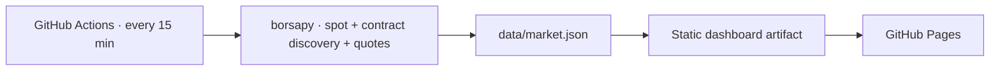

# Vade — TRY VİOP Futures Curves

A zero-backend GitHub Pages dashboard for USD/TRY, EUR/TRY, and XAU/TRY spot
references and every listed futures contract on Borsa İstanbul's VİOP market.
Market data is pulled with [borsapy](https://github.com/saidsurucu/borsapy) and
redeployed every 15 minutes by GitHub Actions.

## What it shows

- A top-level switch for USD/TRY, EUR/TRY, and XAU/TRY
- Current spot reference, daily range, and daily change for each market
- Automatic discovery of new dated contracts across all three VİOP families
- Last price, daily change, bid/ask, volume, and premium to spot
- Official contract maturity date and calendar days remaining
- Responsive price and implied-yield curves plus the full contract board
- Daily, 30-day monthly, and 365-day annualized yields in the chart and contract table
- For USD/TRY, the spot's average daily appreciation over the last 180 days and
  the expected profit from shorting each contract at the bid
- Snapshot age, delayed-data state, and one-click refresh

Maturity is calculated as the final **full** Turkish business day of each
contract month. Weekends, public holidays, and half-day official holidays are
excluded in line with Borsa İstanbul's
[FX](https://www.borsaistanbul.com/en/markets/viop/futures/fx-futures) and
[precious-metals](https://www.borsaistanbul.com/en/markets/viop/futures/precious-metals-futures)
futures specifications.

## How it works



The scheduled job only replaces the live site after a complete, valid snapshot
is produced. If upstream market data is temporarily unavailable, the job fails
and the previous successful Pages deployment stays online.

The yield curve starts with the gross daily factor
`(contract price / spot rate)^(1 / days left)`. The chart converts the selected
1-, 30-, or 365-day compounded factor to net percentage yield by subtracting
one and multiplying by 100.

### USD/TRY short carry

The short-carry section projects spot forward at its recent pace and compares
that with the price a short could sell at today:

- **Daily appreciation** = `(spot today / spot 180 days ago)^(1 / days)`. The
  start is the last daily close on or before 180 calendar days ago, so the
  window is exactly 180 days unless that date was a weekend or holiday, in which
  case the exponent uses the actual gap.
- **Expected spot at maturity** = `spot today × daily appreciation^(days left)`
- **Expected profit** = `(bid − expected spot at maturity) × 1,000` TRY per
  contract, since one VİOP USD/TRY contract is 1,000 USD.

Contracts without a bid show no profit. The projection ignores fees, taxes, and
margin and is not a forecast. If the 180-day history cannot be fetched, the
rest of the snapshot still publishes without the projection.

## History

Each refresh overwrites `data/market.json`, so the Pages workflow also keeps one
end-of-day snapshot per VİOP trading day on a separate `data-history` branch.
`main` never receives these commits.

- **Layout.** `history/<YYYY-MM-DD>.json` holds the snapshot exactly as
  `scripts/update_data.py` wrote it, named after the trading day it closes.
  `history/index.json` lists the archived days, sorted by date, as
  `{ "date", "generated_at", "markets" }` entries under a `schema_version`, so
  the dashboard never needs a directory listing.
- **End-of-day rule.** VİOP's
  [trading hours](https://www.borsaistanbul.com/en/markets/viop/market-functioning/trading-hours)
  run from the 09:20 opening session through the 19:00–23:00 evening session
  for FX and precious-metal futures. A snapshot taken at or after 23:15 on
  trading day D counts as D; the 15 minutes allow for delayed quotes. So does
  any snapshot taken before the next session opens at 09:20, including over
  weekends and public holidays. Snapshots taken in between, including the gap
  between the normal and evening sessions, are not end-of-day and are skipped.
- **Half days.** A half-day holiday is still a trading day, but its only session
  ends at 12:40 and it has no evening session, so snapshots from 12:55 onward
  count as that day. On the year's last trading day the evening session is not
  held either; the archive still waits until 23:15, which only delays it.
- **Write-once.** The first end-of-day snapshot for a day wins. An existing day
  is never overwritten, and a run that adds nothing makes no commit.
- **Size.** About 27 KB per trading day, roughly 7 MB a year.

The `archive` job runs after `build`, alongside `deploy`, so a failed archive
never blocks or undoes the Pages deploy. It is the only job with
`contents: write` and pushes only to `data-history`, never with force. The
logic lives in `scripts/archive_snapshot.py`, and
`scripts/archive_history.sh SNAPSHOT [WORKTREE]` runs it against a checkout of
the branch, creating the branch as an orphan holding only `history/` on the
first run.

## Publish on GitHub Pages

1. Push this repository to GitHub with `main` as the default branch.
2. Open **Settings → Pages** and choose **GitHub Actions** as the source.
3. Open **Actions** and run **Refresh market data and deploy Pages**, or wait for
   the push-triggered run.

The same workflow runs at `*/15 * * * *` and can also be started manually.
GitHub may delay scheduled jobs during periods of high load, and scheduled
workflows in inactive public repositories can be disabled after 60 days.

## Run locally

Python 3.10 or newer is required (the workflow uses Python 3.12).

```bash
python -m venv .venv
source .venv/bin/activate
python -m pip install -r requirements.txt
python -m unittest discover -s tests -v
python scripts/update_data.py
python -m http.server 8000
```

Then open <http://localhost:8000>.

To assemble the deployable site into `_site/` exactly as the Pages workflow
does, run `bash scripts/build_site.sh`.

To run the headless browser smoke test of the dashboard, install the dev
requirements and a Playwright Chromium, then run the test directly:

```bash
python -m pip install -r requirements-dev.txt
python -m playwright install chromium
python -m unittest tests/e2e/test_dashboard_smoke.py -v
```

It builds `_site/`, swaps in the fixed snapshot `tests/fixtures/market.json`,
serves it on a local port, and checks every market in headless Chromium for
console errors and the main rendered values. It never touches the network. The
`discover` command above skips it, so the updater tests still run without a
browser.

## Continuous integration

`.github/workflows/ci.yml` runs on every pull request, on pushes to branches
other than `main`, and on demand. It never deploys. It runs the updater tests
offline on Python 3.10 and 3.12, checks `app.js` syntax with `node --check`,
checks that `data/market.json` parses, and assembles the site with
`scripts/build_site.sh`, which fails if any file the site needs is missing.
A separate `smoke` job installs `requirements-dev.txt` and Chromium and runs
`python -m unittest tests/e2e/test_dashboard_smoke.py -v`.

## Data notes

- Futures discovery uses `borsapy.viop_contracts(..., full_info=True)` for
  `USDTRY`, `EURTRY`, and `XAUTRY`.
- Quotes use `borsapy.TradingViewStream`; the borsapy VİOP table provides a
  fallback and supplementary turnover data.
- USD/TRY and EUR/TRY spot use borsapy's 15-minute FX history with `.current`
  as a fallback. XAU/TRY combines 15-minute XAU/USD and USD/TRY data into a
  TRY-per-gram reference, with `FX("gram-altin").current` as a fallback.
- The 180-day USD/TRY reference uses borsapy's daily FX history
  (`FX("USD").history(...)`, sourced from canlidoviz).
- The dashboard polls its deployed JSON every minute, while the published
  snapshot is rebuilt on the 15-minute GitHub Actions schedule.
- VİOP and TradingView market data may be delayed by approximately 15 minutes.

This project is for personal and educational use only. It is not investment
advice. Review borsapy's upstream data-license disclaimer before use; commercial
market-data use may require a Borsa İstanbul license.
